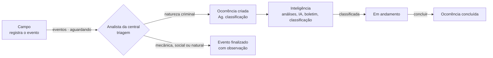
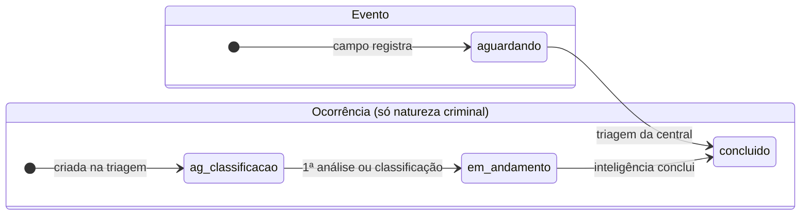
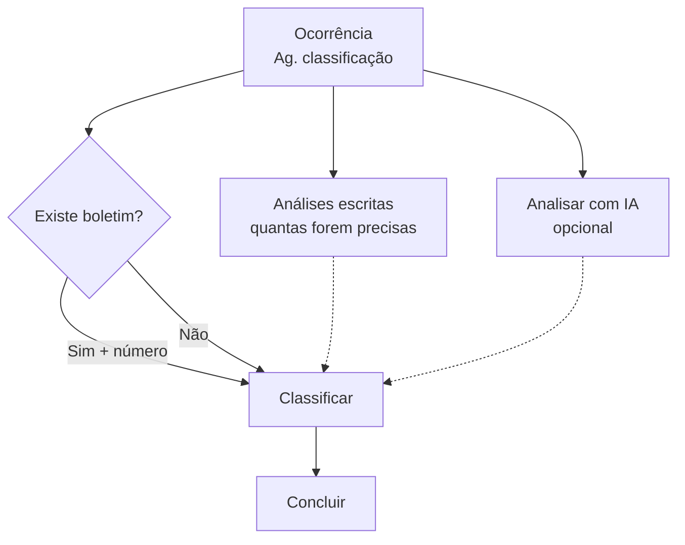

# Fluxo de registro de ocorrências

**Campo ➜ Analista da central ➜ Inteligência**

Este documento descreve o caminho de um fato desde o registro no celular até a conclusão da ocorrência: quem age em cada etapa, o que vê na tela, o que o banco confere e o que fica gravado.
Ele foi escrito a partir do código atual (`js/campo.js`, `js/app.js`, `js/data.js` e `supabase/migrations/001` a `004`).

## Visão geral

| Etapa | Perfil | Painel | Entrada | Saída |
|---|---|---|---|---|
| 1. Registro | `campo` | Campo (celular) | o fato visto em campo | **evento** com status `aguardando` |
| 2. Triagem | `central` (analista) | Central | evento aguardando | **ocorrência** (criminal) ou **evento finalizado** (demais naturezas) |
| 3. Investigação | `inteligencia` | Inteligência | ocorrência | ocorrência **classificada** e **concluída** |

O perfil `admin` pode fazer tudo e troca de painel pelo menu da conta.

### Situações (status) de cada registro

| Registro | Status no banco | Texto na tela |
|---|---|---|
| Evento | `aguardando` | "Aguardando", com cor por tempo: normal, atenção (≥ 4 h) ou atrasado (≥ 24 h) |
| Evento | `concluido` | "Concluído" |
| Ocorrência | `ag_classificacao` | "Ag. classificação" |
| Ocorrência | `em_andamento` | "Em andamento" |
| Ocorrência | `concluido` | "Concluída" |

Nenhuma etapa volta atrás: não é possível reabrir um evento triado nem alterar uma classificação.

---

## 1. Campo: registro do evento

**Quem:** equipe de campo, no celular (o painel é um app instalável que abre sem internet).
**Tela:** registro em 4 passos: **Local ➜ Relato ➜ Fotos ➜ Revisar**.

| Passo | O que a pessoa informa | Regras |
|---|---|---|
| Local | onde aconteceu; GPS opcional | texto obrigatório, até 120 caracteres; o GPS só é aceito com latitude e longitude juntas |
| Relato | o que aconteceu | obrigatório, até 4.000 caracteres |
| Fotos | até 6 fotos | reduzidas no aparelho (até 1600 px, qualidade 0,8) antes do envio |
| Revisar | confere tudo e envia | o rascunho fica salvo no aparelho até o envio |

**Envio, com ou sem sinal:**
1. Ao enviar, o registro (texto, horário, GPS e fotos) é gravado **primeiro no aparelho**, numa fila do navegador (IndexedDB, em `js/fila.js`).
2. Com conexão, as fotos sobem para a pasta da própria pessoa no bucket `evidencias`. Depois o painel chama `registrar_evento`.
3. Sem conexão, o cartão aparece em "Meus registros" como **"Neste aparelho · Aguardando envio"**. O envio acontece sozinho quando a conexão volta, ou quando o app é aberto de novo.
4. Se o erro não for falta de sinal, o cartão mostra **"Não enviado"** com o motivo, e a pessoa escolhe *Tentar agora* ou *Descartar*.

**O que o banco confere (`registrar_evento`, migração 003):**
- o perfil é `campo`, `central` ou `admin`, e a conta está ativa;
- cada foto está na pasta da própria pessoa;
- o reenvio não duplica: cada registro tem um `client_id`, e o banco devolve o evento que já existe;
- **o horário que vale é o do registro no campo**, não o do envio. Se o relógio do aparelho estiver no futuro ou mais de 30 dias atrás, o banco usa o horário do servidor e anota isso no histórico.

**Resultado:** um **evento** com número anual (`0001 / 2026`), status `aguardando`, autor, fotos e GPS.
A pessoa do campo acompanha **só os próprios registros**.

---

## 2. Analista da central: triagem

**Quem:** analista da central de atendimento (perfil `central`).
**Tela:** fila de eventos, ordenada do mais antigo para o mais novo. A fila se atualiza sozinha: em tempo real e, por segurança, a cada 60 s.

**Indicadores:** eventos aguardando, eventos fora do prazo, concluídos hoje, tempo médio de triagem e espera do evento mais antigo.
O cronômetro conta **desde o registro no campo**. O prazo de atenção é 4 h e o de atraso é 24 h (`PRAZO_ATENCAO_H` e `PRAZO_CRITICO_H` em `js/config.js`, valores a validar com a Rumo).

**Passos da triagem:**
1. Abrir o evento e conferir local, relato, fotos e mapa.
2. Escolher **Natureza ➜ Tipo ➜ Subtipo**. São 156 combinações, vindas da planilha da Rumo (tabela `tipificacao`).
3. Preencher o **formulário da combinação**. São 9 modelos: composição, via, apreensão, pessoas, acidente, obstrução, manutenção, prevenção e básico.
   - Obrigatórios: só o **km** (formato `115+500`) e, na apreensão, o **material localizado**.
   - Formatos: hora `HH:MM`; quantidade de material **só em número de recipientes**, sem peso nem litros.
   - O campo "SB" mostra as siglas cadastradas e preenche o trecho sozinho.
4. Completar conforme a natureza:

| Natureza | O analista informa | O que acontece |
|---|---|---|
| **Criminal** | data e hora do fato (obrigatório), forma de conhecimento (solicitação, flagrante ou denúncia) e análise de mesa | o evento é concluído e uma **ocorrência** é criada para a inteligência |
| **Mecânica, social ou natural** | observação do que foi feito (obrigatório) | o evento é **finalizado**, sem ocorrência |

5. Confirmar. A tela avisa que **não dá para desfazer**.

**O que o banco confere (`triar_evento`, migração 004):**
- o perfil é `central` ou `admin`;
- o evento ainda está aguardando, para que duas pessoas não façam a triagem do mesmo evento;
- a combinação existe e está ativa, e o formulário dela está ativo;
- os campos do formulário são validados de novo no banco, com as mesmas regras da tela. Campo inexistente, obrigatório vazio ou formato errado são recusados;
- no caso criminal, a data do fato é obrigatória e não pode estar no futuro.

**Resultado:**
- **No evento:** a tipificação, os dados do formulário, quem fez a triagem e quando.
- **No caso criminal, na ocorrência nova:** número anual próprio, tipo, subtipo, natureza, dados do formulário, data do fato, forma de conhecimento, análise de mesa e o GPS do evento.

> **Atenção:** em 09/11/2026, a migração 004 ainda não tinha sido aplicada no banco de produção, então a triagem falha lá. Veja `docs/SQL-FALTANTE.md`.

---

## 3. Inteligência: análise, boletim, classificação e conclusão

**Quem:** equipe de inteligência (perfil `inteligencia`).
**Tela:** fila de ocorrências, com estes indicadores: aguardando classificação, em andamento, sem resposta de boletim, concluídas hoje, tempo médio e a mais antiga. Também há gráficos por tipo e por classificação dos últimos 30 dias.

A ordem abaixo é a que o banco exige. As análises podem ser feitas a qualquer momento antes da conclusão.

| Ação | Função no banco | Regras |
|---|---|---|
| **Adicionar análise** (texto livre) | `adicionar_analise` | `central`, `inteligencia` ou `admin`; não aceita ocorrência concluída. A 1ª análise muda o status para "Em andamento" |
| **Analisar com IA** | função `analisar-ocorrencia` ➜ `salvar_analise_ia` | só `inteligencia` e `admin`; no máximo uma análise a cada 15 s por ocorrência; a resposta é validada antes de gravar |
| **Informar boletim** | `responder_boletim` | Sim (com número obrigatório) ou Não |
| **Classificar** | `classificar_ocorrencia` | só depois de responder sobre o boletim; uma vez só, **sem alteração**; tira a ocorrência de "Ag. classificação" |
| **Concluir** | `concluir_ocorrencia` | só depois de classificar; a ocorrência sai da fila de trabalho |

**Classificações possíveis:** Prevenção, Natural, Mecânica, Social e Criminal.
A classificação da inteligência é um campo **separado** da natureza escolhida na triagem.

**Análise por IA, como está hoje:** a função `supabase/functions/analisar-ocorrencia` confere o login e o perfil e lê a ocorrência com as permissões de quem pediu. Depois faz **uma** chamada à OpenAI (`gpt-4o-mini`, chave só no servidor) e devolve:
- nota de qualidade do registro;
- viabilidade de boletim;
- artigo do Código Penal (uso interno);
- minuta de até 1.200 caracteres;
- lista do que não foi informado.

O texto do registro é tratado como dado, não como instrução. **O resultado é uma sugestão: quem registra o boletim confere cada fato.**
O README descreve uma versão com 3 agentes em cadeia e minutas aprovadas (migração 005), que ainda não existe no repositório nem no banco.

---

## Regras que valem para o fluxo todo

- **Escrita só pelas funções do banco.** O navegador não grava direto nas tabelas do fluxo. Cada função confere perfil, situação e dados. Não há caminho para pular etapas ou campos obrigatórios.
- **Quem vê o quê:**

| Dado | campo | central | inteligencia | admin |
|---|---|---|---|---|
| Eventos | só os próprios | todos | todos | todos |
| Ocorrências e análises escritas | não | todas | todas | todas |
| Análises de IA | não | não | todas | todas |
| Histórico de auditoria | não | não | sim | sim |

- **Contas novas nascem inativas** e não abrem nenhum painel até o administrador liberar e definir o perfil.
- **Fotos** ficam em bucket privado e são abertas por links temporários de 1 hora.
- **Histórico:** cada passo grava uma linha em `historico`, com quem fez, quando e detalhes. Os registros são: registrado, triagem criminal ou finalizado, ocorrência criada, análise adicionada, IA analisada, boletim respondido, classificada e concluída.
- **Numeração:** eventos e ocorrências têm sequências separadas por ano, no fuso `America/Sao_Paulo`.
- **Exportação:** as duas filas podem ser exportadas pela tela, com os filtros aplicados.

## Pontos em aberto com a Rumo

- Prazos do cronômetro (4 h e 24 h) são valores de referência.
- A forma oficial de encerrar a ocorrência não foi mostrada. Hoje a inteligência conclui depois de classificar.
- Hoje, classificar já tira a ocorrência de "Ag. classificação", mesmo sem análise. No Rumo - SLA, o status só mudava com a análise.
- Os 9 formulários e seus campos obrigatórios são uma proposta, a validar.
- Falta minuta para roubo, ataques, incêndio criminoso, receptação e dano em instalações de via.
- A pessoa do campo não recebe aviso quando o evento é triado: ela só vê o status em "Meus registros".
- Os avisos de prazo vencido (e-mail ou WhatsApp) ainda não existem.
